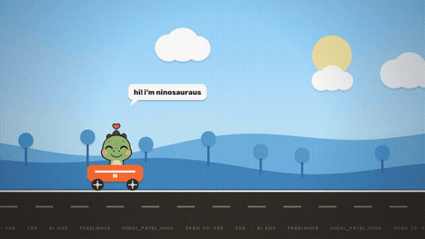
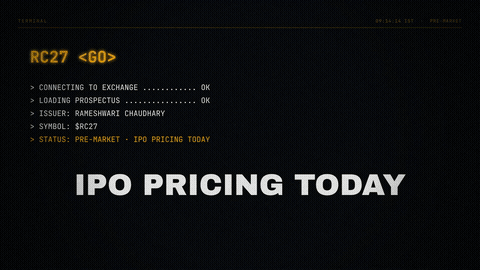
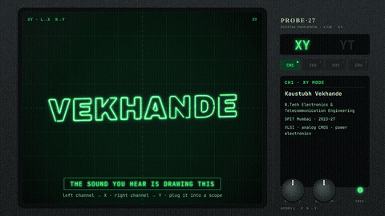

# resumotion°

**Attach your resume. Get a 60-second motion-graphics reel — invented for you, not from a template.**

A Claude skill. Works in Claude Code and claude.ai. No timeline software, no After Effects, no design skills needed.

→ **[resumotion.vercel.app](https://resumotion.vercel.app)** · built by [Nidhi Patel](https://nidhipatel28.vercel.app) · [@Ninosauraus](https://x.com/Ninosauraus)

---

## Install

**Windows:** [Download resumotion.zip](https://github.com/NIDHIPATEL2807/Resumotion/releases/latest/download/resumotion.zip) → unzip → move the `resumotion\` folder to `%USERPROFILE%\.claude\skills\`

**Mac / Linux — one command:**
```bash
mkdir -p ~/.claude/skills && curl -fsSL https://github.com/NIDHIPATEL2807/Resumotion/releases/latest/download/resumotion.tar.gz | tar -xz -C ~/.claude/skills
```

**Claude.ai:** Download the zip → open the folder → upload `SKILL.md` to a Claude.ai Project as a Project file.

---

## Showcase

<table>
<tr>
<td align="center" width="50%">
<br/>
<b>Signal Hijack</b> · Nidhi
</td>
<td align="center" width="50%">
<br/>
<b>Speedrun</b> · Nino
</td>
</tr>
<tr>
<td align="center" width="50%">
<br/>
<b>IPO Day</b> · Rameshwari
</td>
<td align="center" width="50%">
<br/>
<b>Perception</b> · Nidhi
</td>
</tr>
<tr>
<td align="center" width="50%">
<br/>
<b>XY Mode</b> · Kaustubh
</td>
<td align="center" width="50%">
<i>Your reel here — <a href="https://x.com/Ninosauraus">tag @Ninosauraus</a></i>
</td>
</tr>
</table>

---

## How to use

1. Attach your resume (PDF, text, or paste it)
2. Say **"make my reel"** or **`/resumotion`**
3. Claude reads your resume and proposes a concept — original, or closest theme
4. You approve (or tweak) the concept
5. Claude builds a self-contained HTML with canvas animation + synthesised music
6. Open it in your browser → **▶ Play** to preview, **⏺ Record** to export video

The HTML works offline. No API keys. No subscriptions. No uploads.

---

## Themes

| Theme | Vibe | For |
|---|---|---|
| **Signal Hijack** | Pirate broadcast, channel-flip on the beat | Anyone with 3+ distinct things — loud, playful, chaotic |
| **Speedrun** | Any-% energy, fast cuts, mascot-friendly | Hackers, game devs, people with a strong online identity |
| **IPO Day** | Big-room gravity, market-bell cinematic | Finance, IB, equity research, consulting, MBA |
| **Prospectus** | Editorial weight, premium and calm | Law, policy, NGO, senior finance |
| **Perception** | Slow-burn visual essay, oscilloscope aesthetic | ML engineers, computer vision, AI/robotics |
| **Blueprint** | Clean engineering diagrams, embedded feel | Electronics, VLSI, mechanical, embedded systems |
| **General** | Editorial timeline, warm and readable | Teachers, HR, ops, healthcare, architecture — anyone |

You are never locked to a theme. Claude can invent a concept from scratch.

---

## Rendering to MP4 / GIF (optional)

The browser **⏺ Record** button works everywhere — nothing to install.

For automated high-quality export (requires Node ≥ 20, ffmpeg):

```bash
cd resumotion/scripts
npm install
npx playwright install chromium   # one-time

node render.js my-reel.html --name my-reel
# outputs: out/my-reel-master.mp4  (1080p)  +  out/my-reel-social.mp4  (vertical crop)
```

---

## Contributing

PRs welcome. The most useful contributions:

- **New themes** — add a `THEME.md` to `resumotion/assets/themes/your-theme/` following the template in `_template/`. Include a reference reel if you have one.
- **Bug fixes in the toolkit** — the render pipeline lives in `resumotion/toolkit/`
- **Retrospective notes** — if you build a reel, add a short note to `references/RETROSPECTIVES.md` about what worked and what didn't

Before opening a PR:
1. Your theme must have a `THEME.md` with palette, who it's for, and at least one scene breakdown
2. Test with at least one real resume — don't commit a theme that's never been run
3. Keep `SKILL.md` clean — it is the file users read before installing

---

## FAQ

**Claude isn't using the skill**
Restart Claude Code, then mention it by name: *"use the resumotion skill to make my reel"*. To check it is installed: `ls ~/.claude/skills/resumotion` — you should see `SKILL.md`.

**How do I update?**
Run the install command again — it overwrites the old version.

**How do I remove it?**
`rm -rf ~/.claude/skills/resumotion`

**Can I use this for commercial work?**
Yes. MIT licensed. Keep the licence file with the skill if you share it.

**Does it work without internet?**
The HTML reel works fully offline once generated. The install command needs internet once to download the skill.

---

## License

MIT — see [LICENSE](LICENSE).

---

---

*Post your reel and tag [@Ninosauraus](https://x.com/Ninosauraus) — made by [Nidhi Patel](https://nidhipatel28.vercel.app) · [LinkedIn](https://www.linkedin.com/in/nidhi-patel-424674252/) · [GitHub](https://github.com/NIDHIPATEL2807)*
